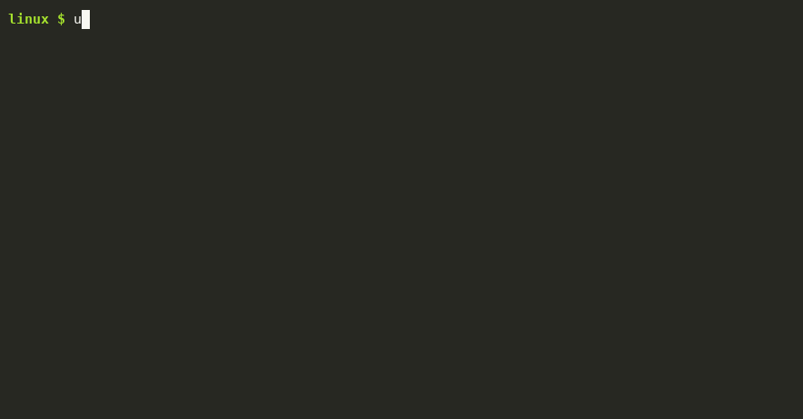
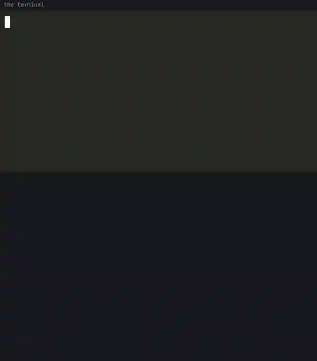
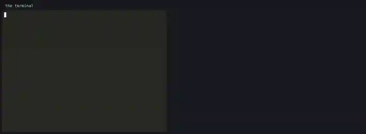

<p align="center">
  
</p>

<h1 align="center">tabc</h1>

<p align="center">
  <b>Run containers in a browser tab.</b>
</p>

<p align="center">
  <a href="#install">Install</a> ·
  <a href="#use">Use</a> ·
  <a href="#how-it-works">How it works</a> ·
  <a href="#hacking">Hacking</a> ·
  <a href="docs/design.md">Design</a>
</p>

<p align="center">
  <a href="https://github.com/fzakaria/tabc/actions/workflows/ci.yml"></a>
</p>

tabc is an OCI runtime, like runc. Where runc starts your container as
a Linux process, tabc starts headless Chromium and boots the container
inside a tab, on a Linux kernel compiled to WebAssembly. The tab is the
sandbox.

<p align="center"><a href="docs/img/demo.webp"></a></p>

```console
$ docker run --rm --runtime tabc --platform linux/arm64 alpine uname -sm
Linux aarch64
```

tabc needs no Linux underneath, so it works on a Mac without a VM.
With `--open` the container runs in a tab of your own browser, and
what you type in the tab or in the terminal shows in both:

```console
$ tabc run -it --open -p 8123:80 nginx:alpine sh
```

<p align="center"><a href="docs/img/tab.webp"></a></p>

Compose works too, through `tocker`, tabc's stand-in for the `docker`
command. Every service is started in their own tab:

```console
$ tocker compose up
```

<p align="center"><a href="docs/img/compose.webp"></a></p>

## Install

With Nix, on Linux or an Apple Silicon Mac:

```console
$ nix run github:fzakaria/tabc -- run alpine echo hi
hi
```

Without Nix, each [release] has an archive for Linux and for a Mac,
x86-64 and arm64:

```console
$ curl -L https://github.com/fzakaria/tabc/releases/latest/download/tabc-linux-amd64.tar.gz | tar -xz
$ ./tabc-linux-amd64/tabc run alpine echo hi
hi
```

A release's tabc uses the Chrome or Chromium you have installed, and
`tocker` the `docker` command line you have installed.

tabc is one file, and `tocker` is the same file under another name. On
Linux the Nix package brings its own Chromium. On a Mac tabc looks for
Chrome in `/Applications`, or uses the one `TABC_CHROMIUM` points at.
With `--open` the container runs in the browser you already have.

## Use

### On its own

tabc pulls the image and runs it. The flags are the ones you know from
`docker run`.

```console
$ tabc run python:3.13-alpine python -c 'print(6 * 7)'
42
$ echo hello | tabc run -i alpine tr a-z A-Z
HELLO
$ tabc run -p 8080:80 nginx:alpine          # then curl localhost:8080
$ tabc run -v "$PWD":/work -w /work alpine ls
```

| flag                   | what it does                                  |
| ---------------------- | --------------------------------------------- |
| `-i`, `-t`             | keep stdin open, give the program a terminal  |
| `-e`, `-w`, `-u`, `-m` | environment, directory, user, memory          |
| `--cpus`               | how many CPUs the guest has, 2 is the default |
| `-p host:container`    | publish a port, on loopback by default        |
| `-v dir:/path[:ro]`    | mount a directory, live and writable          |
| `--name`, `--network`  | let containers find each other by name        |
| `--open`, `--link`     | run in your own browser instead of headless   |

### In your browser

```console
$ tabc run -it --open alpine sh
```

The container opens as a tab you can see, with a terminal in it. Type
in the tab or in the terminal you started it from; each shows the
other. `--link` prints the address and waits for you to open it.

### Compose, without a Docker daemon

The `docker` program is only a client: every command is a request to a
daemon that remembers which containers exist. A machine without Docker
has no such daemon, so tabc includes a minimal one. `tocker` starts that
daemon if it isn't running, then runs the `docker` client pointed at
it, so `docker` commands work unchanged, Compose included.

```console
$ nix run github:fzakaria/tabc#tocker -- run -it alpine sh
$ tocker compose up
$ tocker exec -it work-web-1 sh   # a shell beside a running program
$ tocker --dashboard compose up   # every service as a pane in one page
$ tocker --stop                   # stop the daemon and its containers
```

Nothing in your `compose.yaml` changes. [examples/compose](examples/compose)
is a web server and the Redis it counts its visits in.

### With Docker, as its runtime

If you do have Docker, tabc can be the runtime it uses instead of runc.
Register it in `/etc/docker/daemon.json` and restart the daemon:

```json
{ "runtimes": { "tabc": { "path": "/path/to/tabc" } } }
```

On NixOS that is one line:

```nix
virtualisation.docker.daemon.settings.runtimes.tabc.path = "${tabc}/bin/tabc";
```

Then name it per container:

```console
$ docker run --rm -it --runtime tabc --platform linux/arm64 debian bash
```

`docker exec` works on a container started this way, as it does on any
other.

For Compose the runtime is a line on each service, not a flag to
`docker compose up`:

```yaml
services:
  web:
    image: python:3.13-alpine
    runtime: tabc
    platform: linux/arm64
```

Docker's networks, `-p` and volumes then work as they do with runc.
Podman needs no setup:

```console
$ podman run --rm --runtime /path/to/tabc --platform linux/arm64 alpine echo hi
```

## How it works

1. The engine, Docker or Podman, calls `tabc create` as it would call
   runc.
2. tabc starts a supervisor, and the supervisor starts headless
   Chromium with a fresh profile on a page it serves from loopback.
3. The page boots [unkernel], a Linux kernel built for WebAssembly
   that runs aarch64 programs.
4. The guest mounts the image. Every file it opens is a request back
   to the supervisor, which reads it from the bundle or straight out
   of the image's layers, so the image is never unpacked.
5. `tabc start` runs your program in the guest. Its input and output
   travel over a WebSocket to the supervisor. So does every network
   connection the program makes; the supervisor opens each one from
   inside the container's network namespace.
6. For inbound connections, the supervisor listens on the ports the
   program opens and carries each connection into the tab.

The engine treats the supervisor as the container, and takes the pid,
exit status and stdio from it. [docs/design.md](docs/design.md) has
the details.

## Hacking

```console
$ nix build                # the runtime, one file
$ nix flake check          # unit tests, and containers in a real Chromium
$ nix build .#tabc-darwin  # a Mac binary, built on Linux
$ nix fmt                  # before committing
```

## Credits

[unkernel] by Pooya Parsa does the hard part: Linux as a WebAssembly
module, and the SDK that boots it.

## License

MIT, please see [LICENSE](LICENSE). unkernel's kernel is GPL-2.0.

[unkernel]: https://github.com/pithings/unkernel
[release]: https://github.com/fzakaria/tabc/releases
